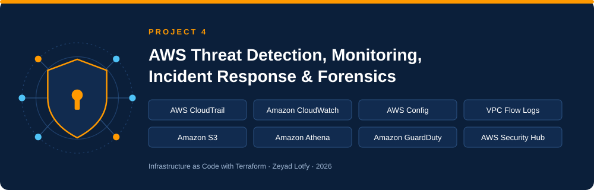

# AWS Threat Detection – Week 1: Logging & Audit Foundation

This Terraform project is designed for **one AWS account containing four IAM users**.
It does not create or require AWS Organizations.

## Files

- `versions.tf` – Terraform and provider versions.
- `provider.tf` – AWS provider configuration and default tags.
- `variables.tf` – input variable declarations.
- `terraform.tfvars.example` – example values; copy to `terraform.tfvars`.
- `data.tf` – AWS account and partition data sources.
- `locals.tf` – generated unique names.
- `s3_central.tf` – central log bucket, encryption, versioning, lifecycle, and combined bucket policy.
- `cloudwatch.tf` – CloudWatch log groups.
- `cloudtrail.tf` – account-level, multi-region CloudTrail and CloudWatch delivery role.
- `vpc_flow_logs.tf` – VPC Flow Logs and IAM role.
- `config.tf` – AWS Config recorder and delivery channel.
- `s3_access_logs.tf` – sample S3 bucket and server access log destination.
- `elb_logs.tf` – bucket and policy prepared for ELB access logs.
- `athena.tf` – Athena database and workgroup.
- `outputs.tf` – useful resource names and IDs.

## Prerequisites

1. Terraform 1.5 or later.
2. AWS CLI configured with credentials for the target account.
3. An existing VPC in the selected AWS region.
4. An IAM identity with permissions to create the resources in this project.
5. AWS Config must not already have a conflicting recorder/delivery channel in the region. AWS Config supports one customer-managed configuration recorder per region.

## Setup

```bash
cp terraform.tfvars.example terraform.tfvars
```

Edit `terraform.tfvars` and set the real `vpc_id`.

Check the AWS identity:

```bash
aws sts get-caller-identity
```

Run Terraform:

```bash
terraform init
terraform fmt -recursive
terraform validate
terraform plan
terraform apply
```

## Important notes

- CloudTrail is an **account-level trail** (`is_organization_trail = false`) and records activity for IAM users in this account.
- Multi-region trail means events from enabled AWS regions are collected by this trail; it does not create an AWS Organization.
- The ELB bucket is prepared, but no load balancer is created or modified. Enable access logs on an existing ALB/NLB separately.
- The Athena database and workgroup are created, but an Athena table must still be defined before running SQL queries against CloudTrail files.
- The S3 access logging example creates a sample application bucket. If you want to log an existing bucket, change the source bucket resource to a data source or attach `aws_s3_bucket_logging` to that bucket.
- `force_destroy = false` is intentional to reduce the risk of deleting log data. Empty the buckets deliberately before destroying the project.
- S3 lifecycle expiration is a retention setting, not a legal/compliance guarantee. Confirm your required retention period before using this in production.
- This is a learning baseline. Review service-specific permissions, organization requirements, region coverage, encryption, and retention before production use.

## Cleanup

After reviewing and preserving any evidence you need:

```bash
terraform destroy
```

Because the buckets use `force_destroy = false`, Terraform may refuse to delete non-empty buckets. Review and empty them deliberately before retrying.
